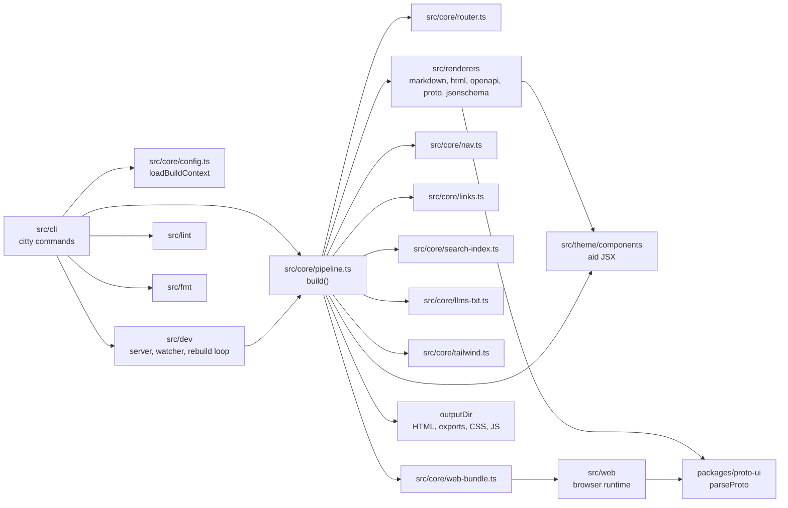

aid has one build path. The CLI loads the config into a `BuildContext`, and `build()` in `src/core/pipeline.ts` turns the content directory into an output directory. `aid dev` calls the same `build()` on every change. `aid lint` and `aid fmt` do not touch the pipeline.

## Module graph

- `src/cli/main.ts` defines the root command. Each subcommand module loads on first use.
- The renderers return a `RenderedPage` with body HTML only. The pipeline wraps it in `Layout` from `src/theme/components/Layout.tsx`.
- `packages/proto-ui` runs in two places. At build time, `src/renderers/proto/index.ts` calls `parseProto` from `@aid/proto-ui/parser` for the page title, description, and search tokens. In the browser, `src/web/proto-entry.ts` calls `createProtoReference` from `@aid/proto-ui/hydrate`, which fetches the `.proto` export and renders the React UI.
- `src/web` holds the browser entries. `src/core/web-entries.ts` lists them, and `src/core/web-bundle.ts` writes only the bundles the site needs.
- `src/lint` and `src/fmt` share the file discovery in `src/lint/discovery.ts` and wrap external tools: markdownlint, Spectral, `bun lint` and `bun fmt`, and buf. `aid lint` also runs its own CSS checks in `src/lint/css.ts`, on lightningcss and the Tailwind compiler. They never call `build()`.

[Build pipeline](./build-pipeline.md) walks through `build()` phase by phase.

## The JSX runtime

The theme components in `src/theme/components/*.tsx` are JSX, but no React runs on the server. `tsconfig.json` sets `"jsx": "react-jsx"` and `"jsxImportSource": "@aid/jsx"`, and its `paths` map `@aid/jsx/jsx-runtime` to `src/jsx-runtime.ts` and `@aid/jsx/jsx-dev-runtime` to `src/jsx-dev-runtime.ts`. Bun reads the same `tsconfig.json`, so it compiles every `.tsx` file in `src/` against aid's runtime.

`src/jsx-runtime.ts` is a synchronous string renderer:

- `jsx()` returns a plain `{ __aid_jsx, type, props }` object. Function components run when `render()` reaches them.
- `render()` returns an HTML string. It escapes text and attribute values with `Bun.escapeHTML`.
- `RawHtml` and `dangerouslySetInnerHTML` insert markup without escaping. The pipeline uses `RawHtml` to place renderer output inside `Layout`.
- `className` becomes `class` and `htmlFor` becomes `for`. The `key` prop is dropped. Hooks, state, and effects do not exist.
- `renderDocument()` prefixes `<!doctype html>`.

Theme components use the house style (`class`, not `className`). React runs only in the browser, inside the proto-ui bundle. `packages/proto-ui` has its own `tsconfig.json` without the `@aid/jsx` import source, so its components compile against React.

## Core types

`src/core/types.ts` defines the types every phase passes along:

| Type | Role |
| --- | --- |
| `PageKind` | `"markdown" \| "html" \| "openapi" \| "proto" \| "jsonschema"`. It picks the renderer. |
| `Route` | One source file: absolute `source`, public route `path` (without `base_path`), `kind`, and the parsed `frontmatter` once rendered. |
| `RenderedPage` | Renderer output: body `html`, `searchTokens`, side-channel `exports`, the `hasMermaid`, `hasOpenApi`, and `hasProto` flags, `description`, and the `anchors`, `anchorRefs`, and `diagnostics` for link checking. |
| `SideChannelExport` | A machine-readable copy of a page with suffix `.md`, `.json`, or `.proto`. |
| `NavNode` | One sidebar entry: `label`, optional `path`, optional `children`. |
| `BuildContext` | The validated `config` plus the resolved `cwd`, `contentDir`, `outputDir`, `templatesDir`, and `staticDir`. |

## Add a source kind

A new source format touches these places:

1. Add the kind to `PageKind` in `src/core/types.ts`. If it exports a new suffix, widen `SideChannelExport["suffix"]`.
2. Teach the router about the file. Add the extension to the glob in `buildRoutes` (`src/core/router.ts`) and to `KIND_BY_EXT`. For an extension that other files share, add a content sniffer to `classify`, the way `sniffOpenApi` (`src/renderers/openapi/sniff.ts`) and `sniffJsonSchema` (`src/renderers/jsonschema/sniff.ts`) share `.yaml`, `.yml`, and `.json`.
3. Write the renderer under `src/renderers/<kind>/` and return a `RenderedPage`. Return `anchors` if the page has heading ids at build time, so `checkAnchors` can check links into it.
4. Add a `case` to `dispatchRenderer` in `src/core/pipeline.ts`. Markdown and HTML pass `copyAsset` and `resolveLink`. Add the renderer only if the format has relative links or images.
5. Add a `case` to `renderPageBody` in `src/core/pipeline.ts`, either wrapping the body in a page component or passing it through.
6. Add a key for the kind to `SearchWeights` in `src/core/config.ts`. The browser search (`src/web/search.ts`) boosts each result by the weight for its `type`, which is the page kind, and falls back to 1 for a kind without a key. Run `bun run emit-schema` and `bun run gen-docs` after the schema change.
7. If the kind needs browser code, add an entry to `WEB_JS` (and `WEB_CSS` for a prebuilt stylesheet) in `src/core/web-entries.ts`. Add a `has<Kind>` flag to `RenderedPage`, an `include` flag and href in `buildWebBundle`, an href prop on `Layout`, and an empty export to `src/web/_bundled.ts`. `scripts/bundle-web.ts` reads `WEB_JS` and `WEB_CSS`, so it picks up the new entry without changes.
8. Map the new source files to a page in `DOCS_MAP` (`scripts/docs-affected.ts`) and document the format under [content types](../content-types/index.md).
