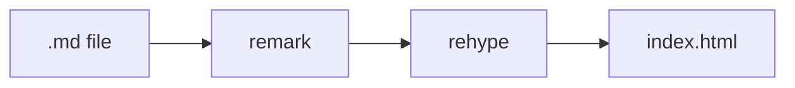

aid renders every `.md` file in the content folder at build time with remark and rehype. The parser follows GitHub Flavored Markdown (GFM) through `remark-gfm`.

## Use it

Write `docs/guides/intro.md`:

```md
---
title: Introduction
description: What the project does and how to install it.
sidebar:
  order: 1
---

Install the CLI before you start.

## Install

Run the installer:

    curl -fsSL https://example.com/install.sh | sh
```

`aid build` writes the page to `dist/guides/intro/index.html` and its export to `dist/guides/intro.md`. The page has the H1 "Introduction", a `## Install` section with an anchor link, and the description in `<meta name="description">`.

## GitHub Flavored Markdown

`remark-gfm` adds tables, task lists, strikethrough, autolink literals, and footnotes to CommonMark. This section uses each one.

- [x] Task lists render as checkboxes.
- [ ] ~~Strikethrough~~ wraps text in `<del>`.
- A bare URL such as <https://github.github.com/gfm/> becomes a link.
- Footnotes collect at the end of the page.[^gfm]

[^gfm]: aid renders footnotes with the `remark-gfm` defaults, including the back link.

## Frontmatter

A page may start with a YAML block between `---` lines. aid parses it with `Bun.YAML` and checks the known keys `title`, `description`, `llms`, and `sidebar`. The [frontmatter reference](../reference/frontmatter.md#markdown-frontmatter) lists their types.

- Other keys are allowed and ignored.
- Malformed YAML, a block that is not a mapping, or a known key with the wrong type fails the build.
- An empty block counts as no frontmatter.

`title` names the page in `<title>`, the sidebar, search results, and llms.txt. `description` fills `<meta name="description">` and the page's line in llms.txt. `llms: optional` moves the page to the optional list in [llms.txt](../llms-txt/index.md). `sidebar` sets the label and order in the [sidebar](./navigation.md#order-and-labels).

## Title and H1

aid decides the title and the H1 from the first element of the body.

- When the body starts with an H1, aid keeps that H1. The title is the frontmatter `title` if set, else the H1 text.
- Otherwise aid inserts an H1 at the top. Its text is the frontmatter `title` if set, else the file name without `.md`, so `intro.md` without a title gets the H1 `intro`.

The inserted H1 exists only in the HTML. The `.md` export does not contain it.

> [!TIP]
> Set `title` in frontmatter and start the body at `##`. markdownlint rule MD025 treats the frontmatter `title` as an H1, so a second H1 in the body is a lint error.

## Heading anchors

`rehype-slug` gives every heading an `id` made from its text. The id is lowercase, spaces become `-`, and punctuation is dropped. A repeated heading gets `-1`, `-2`, and so on. This section's id is `heading-anchors`, so [this link](#heading-anchors) points at it.

`rehype-autolink-headings` then appends an anchor link to every heading:

```html
<h2 id="heading-anchors">Heading anchors<a class="aid-heading-link" aria-hidden="true" tabindex="-1" href="#heading-anchors"><span class="aid-heading-anchor" aria-hidden="true">#</span></a></h2>
```

Style the link through the `aid-heading-link` and `aid-heading-anchor` classes. The [link check](./links.md#fragment-check) validates `#fragment` links against these ids.

## Code blocks

Shiki highlights fenced code at build time with the `github-light` and `github-dark` themes. Each token carries a `light-dark()` color, so the page's `color-scheme` picks the theme without client-side code.

aid loads these grammars: `ts`, `tsx`, `js`, `jsx`, `json`, `json5`, `yaml`, `toml`, `html`, `css`, `md`, `mdx`, `bash`, `sh`, `shell`, `python`, `go`, `rust`, `proto`, `sql`, `docker`, `diff`, `http`. A fence with any other language renders as plain text, and the build does not fail. The list lives in `src/renderers/markdown/shiki.ts`.

```ts
const greeting: string = "highlighted at build time"
```

## Mermaid diagrams

aid turns a fence with the language `mermaid` into `<pre class="mermaid">` and adds the mermaid browser bundle to that page. Pages without a diagram do not load it. Mermaid renders the diagram in the browser and picks its dark theme from the OS color scheme.

````md

````

The fence above renders as:


## Callouts

A blockquote whose first line is a GitHub alert marker becomes a callout. aid supports five types: `NOTE`, `TIP`, `IMPORTANT`, `WARNING`, and `CAUTION`.

```md
> [!NOTE]
> Context the reader may skip.
```

- The marker must be alone on the first line of the blockquote. `> [!NOTE] text` on one line stays a plain blockquote.
- The type is case-insensitive, so `[!note]` works.
- An unknown type, such as `[!DANGER]`, stays a plain blockquote.
- aid renders `<div class="aid-callout aid-callout-note">` with a `<p class="aid-callout-title">Note</p>` first. The title is fixed per type.

`[!NOTE]` renders as:

> [!NOTE]
> Context the reader may skip.

`[!TIP]` renders as:

> [!TIP]
> A shortcut.

`[!IMPORTANT]` renders as:

> [!IMPORTANT]
> A requirement.

`[!WARNING]` renders as:

> [!WARNING]
> A gap, a stub, or a risk of data loss.

`[!CAUTION]` renders as:

> [!CAUTION]
> An action that cannot be undone.

## Raw HTML

aid passes raw HTML in markdown through to the page without sanitizing it. A `<script>` tag in a page runs in the browser.

aid does not rewrite or check links and images written as raw HTML. A raw `<a href="./other.md">` stays as written and breaks once deployed. Use markdown link and image syntax for anything inside the content folder.

## The .md export

aid writes every markdown page's export to `<route>.md`, for example `dist/guides/intro.md`. It is not a copy of the source. aid serializes the parsed tree again with `remark-stringify`:

- the frontmatter is dropped;
- relative links point at route URLs, and colocated images point at their copied URLs, the same as in the HTML;
- callout markers such as `> [!NOTE]` stay in place;
- `remark-stringify` normalizes the formatting, for example list markers become `*`.

## Limitations

> [!WARNING]
> Not supported: MDX, includes or partials, admonition directives such as `:::note`, custom callout titles, and a generated table of contents.
