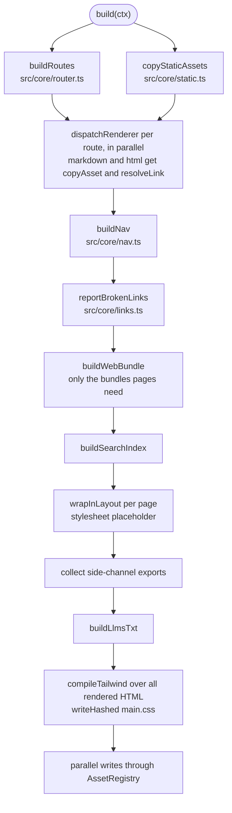

`build(ctx)` in `src/core/pipeline.ts` turns `ctx.contentDir` into `ctx.outputDir`. `aid build` calls it once. `aid dev` calls it on every change.

## Phases

1. `buildRoutes` and `copyStaticAssets` run in parallel.
2. Every route renders in parallel. Markdown and HTML pages copy colocated files and rewrite links while they render.
3. `buildNav` builds the sidebar tree from the rendered pages and the `_meta.yaml` files.
4. `reportBrokenLinks` collects every broken link, image, anchor, and `_meta.yaml` entry and fails the build once.
5. `buildWebBundle` writes the base browser bundle and the optional ones that at least one page needs.
6. `buildSearchIndex` serializes the MiniSearch index, unless `search.enabled` is false.
7. `wrapInLayout` renders each page into a full HTML document in memory, with a placeholder for the stylesheet href.
8. The pipeline collects every side-channel export.
9. `buildLlmsTxt` renders `llms.txt`.
10. `compileTailwind` compiles the stylesheet against every rendered page, and `writeHashed` writes it as `main.<hash>.css`.
11. All pages, exports, `llms.txt`, and the search index are written in parallel. Each page write swaps the placeholder for the real stylesheet href.

## Routes and static files

`buildRoutes` scans `contentDir` with `Bun.Glob("**/*.{md,html,yaml,yml,json,proto}")`:

- A path segment that starts with `_` excludes the file.
- `KIND_BY_EXT` maps `.md`, `.html`, and `.proto` to a `PageKind`.
- `.yaml`, `.yml`, and `.json` files go through `sniffOpenApi` (`src/renderers/openapi/sniff.ts`), which matches an `openapi:` or `swagger:` version key in the first 64 KiB. A file without one goes through `sniffJsonSchema` (`src/renderers/jsonschema/sniff.ts`), which matches a `$schema` key with a `json-schema.org` URL. A file that matches neither is skipped.
- `routePathFromStem` strips the extension and a trailing `index`, so `guides/index.md` and `guides.md` both map to `/guides`. Two sources with one route path throw a route collision error.
- The routes come back sorted by path.

`copyStaticAssets` mirrors `staticDir` into `outputDir` and registers every file with the `AssetRegistry`. A missing `staticDir` copies nothing.

## Rendering

`dispatchRenderer` switches on `route.kind`. For markdown and HTML it builds two callbacks per route:

- `copyAsset` (`makeCopyAsset`) copies a file next to the rendered page, at `<outputDir>/<route>/<basename>`, registers it, and returns its public URL under `base_path`.
- `resolveLink` (`makeResolveLink` in `src/core/links.ts`) resolves a relative href against the source file. A link to a page source becomes the route URL. A link to another file goes through `copyAsset`. Anything else comes back as `broken` with a code: `link/missing`, `link/excluded`, or `link/outside`. Empty, absolute, protocol-relative, and scheme URLs pass through unchanged.

[Links](../content-types/links.md) and [images and static files](../content-types/images-and-static.md) document the author-facing rules.

### Markdown

`renderMarkdown` (`src/renderers/markdown/index.ts`) reads the file and splits off the frontmatter. `extractFrontmatter` parses it with `Bun.YAML` and validates it with `FrontmatterSchema`, and invalid frontmatter throws. The body then runs through two unified stages.

The mdast stage:

1. `remark-parse` and `remark-gfm`.
2. `remarkCalloutMarkers` (`callouts.ts`) turns a `[!NOTE]`-style marker at the start of a blockquote into a raw `html` node, so the `.md` export keeps it unescaped.
3. `colocatedAssetsMdastPlugin` rewrites relative image URLs through `copyAsset`. A missing image adds an `image/missing` message.
4. A link step collects `link` and `definition` nodes and runs `rewriteLinks` (`src/renderers/links.ts`) with `resolveLink`. Broken links become VFile messages. Links with a fragment are kept as `anchorRefs` for the anchor check.

The hast stage:

1. `remark-rehype` with `allowDangerousHtml`.
2. `rehypeCallouts` turns marked blockquotes into `div.aid-callout.aid-callout-<type>` with a title paragraph.
3. A plugin prepends an H1 from the frontmatter `title` (or the filename) when the body does not start with one, and records the page title.
4. `rehype-slug` adds heading ids. A plugin collects the heading texts for search.
5. `rehype-autolink-headings` appends a `#` link to each heading.
6. `mermaidPlugin` rewrites `mermaid` fences to `<pre class="mermaid">` and flags the page as `hasMermaid`. It runs before Shiki.
7. `@shikijs/rehype` highlights code with the options in `shiki.ts`: `github-light` and `github-dark` themes through `light-dark()`, a fixed language list, and plain text for unknown languages.
8. `rehype-stringify`.

The `.md` export comes from the same mdast through `remark-stringify`, after the image and link rewrites, so both outputs carry the same URLs. The export has no frontmatter.

### HTML

`renderHtml` (`src/renderers/html.ts`) requires a full document with `<html>` and `<body>` and throws on a fragment. It parses with `rehype-parse`, moves `<title>` and `<meta name="description">` into `route.frontmatter`, and drops the rest of `<head>`. The body subtree goes through `colocatedAssetsPlugin` and `rewriteLinks` on `<a href>`, and the page counts as `hasMermaid` if it has a `pre.mermaid` or `div.mermaid`. The `.md` export comes from the rewritten body through `rehype-remark`, `remark-gfm` (so tables and strikethrough survive), and `remark-stringify`.

### OpenAPI

`renderOpenApi` (`src/renderers/openapi/index.ts`) calls `parseOpenApi` (`parser.ts`), which uses `normalize`, `upgrade`, and `dereference` from `@scalar/openapi-parser`. The result is an OpenAPI 3.1 document with `$ref`s resolved. Failed `$ref`s print as warnings, and a source that is not a mapping throws. The page shell from `PageOpenAPI` embeds the document as JSON for the Scalar browser bundle. Operation ids, paths, schema names, parameter names, and summaries go into the search extras. The export is the document as `.json`.

### Proto

`renderProto` (`src/renderers/proto/index.ts`) parses the source with `parseProto` from `@aid/proto-ui/parser`, which wraps protobufjs. The parse gives the title (the package name, or the filename), the description (the first paragraph of the package comment), and search extras for messages, services, RPCs, enums, and fields. The page from `PageProto` holds a mount point whose `data-proto-url` points at the `.proto` export. The browser bundle fetches that file and renders the UI. The export is the unchanged source.

### JSON Schema

`renderJsonSchema` (`src/renderers/jsonschema/index.ts`) parses the source with `JSON.parse` or `Bun.YAML.parse`. `buildSchemaDocument` (`model.ts`) turns the schema into a tree of `SchemaNode`s. It resolves `$ref`s inside the file itself, merges compatible `allOf` members, and collapses a `$ref` that is already on the expansion path into a link. It also builds the schema example. Descriptions and the example render through `renderMarkdownFragment` (`markdown.ts`), a remark and rehype pipeline with Shiki that shows raw HTML as escaped text, turns unsafe URL schemes into `#`, and rewrites relative description links through the same `resolveLink` as markdown pages. `PageJsonSchema` renders the static page. The renderer returns `anchors`, so `checkAnchors` checks links into it. The export is the schema as `.json`.

## Colocated asset check

`assertInsideContent` in `src/core/pipeline.ts` runs before every `copyAsset` copy. The source must sit lexically inside `contentDir`, and its `realpath` must sit inside the `realpath` of `contentDir`. The second check stops a symlink inside the content directory from pulling in a file outside it. A failed check throws `aid: colocated asset "<path>" referenced from <page> escapes contentDir`. `tests/integration/security.test.ts` covers both cases.

## Navigation and broken references

`buildNav` (`src/core/nav.ts`) groups the rendered pages by route segment. A folder's `index` page becomes the group link. Labels and order come from the folder's `_meta.yaml`, then the page's frontmatter `sidebar`, then the title. A `_meta.yaml` key that matches no page or folder becomes a `nav/unknown-entry` diagnostic. An invalid `_meta.yaml` throws. See [navigation](../content-types/navigation.md).

The pipeline then hands `reportBrokenLinks` three lists: the renderer diagnostics, the `checkAnchors` results (`link/anchor`, for fragments that match no `id` or `name` on the target page), and the nav diagnostics. OpenAPI and proto pages publish no anchors, so links into them are not checked. JSON Schema pages publish their field and definition ids. `reportBrokenLinks` sorts every problem by file and position and throws one error that lists all of them. With `on_broken_links: warn`, it prints the same report and the build continues.

## Web bundles

`buildWebBundle` (`src/core/web-bundle.ts`) gets three flags: whether any page has mermaid, an OpenAPI page, or a proto page. It always writes `aid-web`, and writes `aid-mermaid`, `aid-openapi`, and `aid-proto` only when their flag is set. OpenAPI and proto pages also get a stylesheet, copied from `@scalar/api-reference/style.css` and `@aid/proto-ui/styles.css`.

From a source checkout, `bundleWebEntry` runs `Bun.build` with code splitting into `outputDir`. Inside the compiled binary, there is no source tree, so the bundles come from the strings embedded in `src/web/_bundled.ts`. [Single binary](./single-binary.md) explains the embedding.

`Layout` links each optional bundle only on the pages that need it.

## Search index

`buildSearchIndex` (`src/core/search-index.ts`) adds one MiniSearch document per page, with the route kind as `type`, and writes `window.__AID_SEARCH__=<index JSON>;` to `search-index.<hash>.js`. `src/core/search-options.ts` holds the MiniSearch options that the build and `src/web/search.ts` share. See [search](../search/index.md).

## Layout wrap

`wrapInLayout` renders `Layout` with `renderDocument`. `renderPageBody` wraps markdown bodies in `PageMarkdown` and HTML bodies in `PageHtml`. OpenAPI, proto, and JSON Schema bodies are already full page components. The stylesheet href is the placeholder `__AID_STYLESHEET_HREF__`, because the CSS hash is unknown until Tailwind has scanned every page.

## llms.txt

`buildLlmsTxt` (`src/core/llms-txt.ts`) fills `<templatesDir>/llms.txt` or a bundled default. Each top-level nav group becomes a section, and pages with `llms: optional` move to the optional list. An unknown placeholder throws. See [llms.txt](../llms-txt/index.md).

## Tailwind compile

`compileTailwind` (`src/core/tailwind.ts`) installs the lightningcss shim first, then imports `@tailwindcss/node` and `@tailwindcss/oxide`. It compiles the project's `stylesheet` file, or the bundled `src/theme/main.css` when that file does not exist:

1. An `@import "aid/theme"` is replaced inline with the bundled theme CSS.
2. `theme.dark_mode` applies: `auto` appends a derived dark palette, `manual` keeps the CSS, and `off` strips `prefers-color-scheme: dark` blocks.
3. `@source` lines are prepended for `src/theme/**/*.{tsx,ts}` in aid's own tree and for the templates directory.
4. The oxide `Scanner` scans those sources plus the HTML of every rendered page for class candidates.

`tailwindcss` imports resolve to aid's own copy, so a project needs no install. See [theming](../theming/index.md).

## Hashing

`writeHashed` writes `<name>.<hash>.<ext>`, where the hash is the first 8 hex characters of `Bun.hash.xxHash64` over the body. It names `main.<hash>.css`, the OpenAPI and proto stylesheets, and the JS bundles inside the compiled binary. The search index uses the same hash. From a source checkout, `Bun.build` names the JS bundles and their chunks with its own `[hash]` placeholder. The hash fingerprints content for caching only.

## Writes and the asset registry

`AssetRegistry` (`src/core/assets.ts`) maps each output path to a source label. Registering the same pair twice does nothing. A different source on the same path throws `aid: asset collision` with both labels, for example a `static/` file that lands on a page export. Static copies, colocated copies, pages, exports, `llms.txt`, and the search index all register. The hashed CSS and JS files are written without registering.

The last phase writes every page, export, `llms.txt`, and the search index in one `Promise.all`.

## Error model

The build fails by throwing. Most messages start with `aid:`:

| Error | Thrown by |
| --- | --- |
| `aid: route collision` | `buildRoutes`, when two sources map to one route path |
| `aid: asset collision` | `AssetRegistry.register` |
| `aid: colocated asset ... escapes contentDir` | `assertInsideContent` |
| `aid: HTML page ... must be a full HTML document` | `renderHtml` |
| `aid: failed to parse OpenAPI source` | `parseOpenApi` |
| `aid: invalid <path>/_meta.yaml` | `buildNav` |
| `aid: unknown llms.txt placeholder` | `buildLlmsTxt` |
| `aid: N broken references` | `reportBrokenLinks`, one error for every broken link, image, anchor, and `_meta.yaml` entry |

Frontmatter errors from Zod and `Bun.YAML` are rethrown as `aid: invalid frontmatter in <file>: <message>`. `aid build` lets the error reach citty's `runMain`, which prints it and exits 1. `aid dev` catches it, keeps serving the last good build, and shows the error in a browser overlay.
