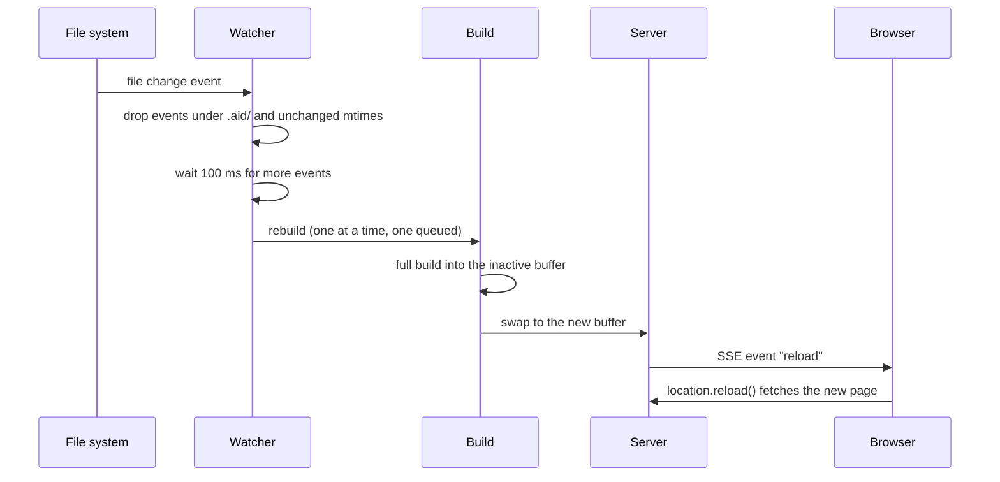

`aid dev` runs the same build as [`aid build`](../commands/build.md), serves the result over HTTP, and rebuilds the whole site when a source file changes. Connected browsers reload after each successful rebuild and show an error overlay after a failed one.

## Use it

```sh
aid dev
```

```text
[aid] initial build: 412ms
[aid] dev server listening at http://localhost:3000/
[aid] rebuilt in 217ms
```

Open the printed URL. Stop the server with Ctrl+C.

## Flags and config

```sh
aid dev [dir] [-f aid.yaml] [--port N] [--host H]
```

| Flag | Default | Effect |
| --- | --- | --- |
| `[dir]` | current directory | Project directory, the folder that holds `aid.yaml`. |
| `--file`, `-f` | `aid.yaml` | Config file, relative to the project directory. |
| `--port` | `dev.port`, 3000 | Port to listen on. aid rejects values outside 0 to 65535. `0` lets the OS pick a free port, and the log prints the port it got. |
| `--host` | `dev.host`, `localhost` | Host to listen on. |

`--port` and `--host` override `dev.port` and `dev.host` in `aid.yaml`. See [the `dev` keys](../reference/configuration.md#dev) in the configuration reference.

If the port is taken, `aid dev` stops with this error:

```text
aid dev: port 3000 on localhost is already in use. Pass --port to choose a different one.
```

## How a rebuild works



### Double-buffered output

`aid dev` does not write to `dir.output`. It builds into two folders under the project directory and swaps between them:

```text
.aid/
  .gitignore     contains "*"
  dev/
    build-a/
    build-b/
```

On start, aid writes `.aid/.gitignore` with `*`, so git ignores the whole folder. Each rebuild deletes the inactive buffer, runs a full build into it, and then points the server at it. The server keeps serving the other buffer until the build finishes, so a browser never sees a half-written site. There is no incremental build. You can delete `.aid/` between sessions.

### What the watcher watches

| Input | How | On change |
| --- | --- | --- |
| `dir.content` (default `docs`) | recursive | rebuild |
| `dir.static` (default `static`) | recursive | rebuild |
| `dir.templates`, when set | recursive | rebuild |
| `stylesheet` (default `main.css`) | the file only | rebuild |
| the config file (`aid.yaml` or the `-f` value) | the file only | session ends |

The watcher ignores every event under `.aid/`, so the dev server's own writes do not trigger rebuilds. It also drops an event when the file's modification time has not moved since the last event, because Bun's recursive watcher on macOS reports reads as well as writes. Events within 100 ms of each other collapse into one rebuild.

aid runs one rebuild at a time. Changes that arrive during a rebuild queue at most one more rebuild, so five quick saves produce at most two builds.

A watched folder or file that does not exist when `aid dev` starts is not watched. If you create `static/` or the stylesheet during a session, restart `aid dev`.

> [!WARNING]
> aid watches the stylesheet file only. Files that the stylesheet `@import`s are not watched, so editing one does not trigger a rebuild. Save the stylesheet itself, or restart `aid dev`.

### Config changes end the session

When the config file changes, aid prints this message, sends it to the browser overlay, and exits with code 0:

```text
[aid] aid.yaml changed. Restart `aid dev` to pick up the new configuration.
```

Start `aid dev` again to load the new config.

## Live reload

The server adds a small script before `</body>` in every HTML response. If a page has no `</body>`, aid inserts the script before `</html>`, or appends it at the end. The script opens a server-sent events (SSE) connection to `/__aid/reload` and handles three events:

| Event | Sent when | Browser effect |
| --- | --- | --- |
| `reload` | a rebuild succeeds | `location.reload()` |
| `error-detail` | a rebuild fails | shows a full-screen overlay with the error message and stack |
| `clear-error` | the next rebuild succeeds | removes the overlay |

The SSE connection has no idle timeout, so it stays open for the whole session. No browser extension is needed. SSE only sends from server to browser.

## Build errors

When a rebuild fails, the server keeps serving the last good build and every open tab shows the overlay. A browser that connects later, for example after a manual refresh, receives the last error as soon as it connects. The next successful rebuild clears the overlay and reloads the page.

When the first build fails, there is no good build to serve. Every request then returns status 503 with an empty page that loads only the reload script, so the overlay shows the error. Fix the error and save. The next successful build replaces the 503 page.

## Routing

- A URL that ends in `/` or has no file extension maps to `index.html` in that folder, so `/guides` serves `guides/index.html`.
- A URL with a dot in its last segment serves the file of that name. When no such file exists, it serves `index.html` in the folder of that name, so the JSON Schema route `/user.schema` serves `user.schema/index.html`.
- A path that resolves outside the build folder, such as an encoded `..`, returns 400 Bad Request.
- A missing file returns 404 Not Found.

With a `base_path` such as `/docs`, the server strips the prefix before it looks up the file. Both `/docs` and `/docs/` serve the site root. Any path outside the prefix, including `/`, gets a 302 redirect to `/docs/`. The startup log prints the URL with the prefix. See [paths and URLs](../configuration/paths-and-urls.md) for how `base_path` shapes the built site.

## Limitations

- Every change rebuilds the whole site.
- Config changes need a restart.
- The server has no authentication. It listens on `localhost` by default. Do not expose it to a public network.
