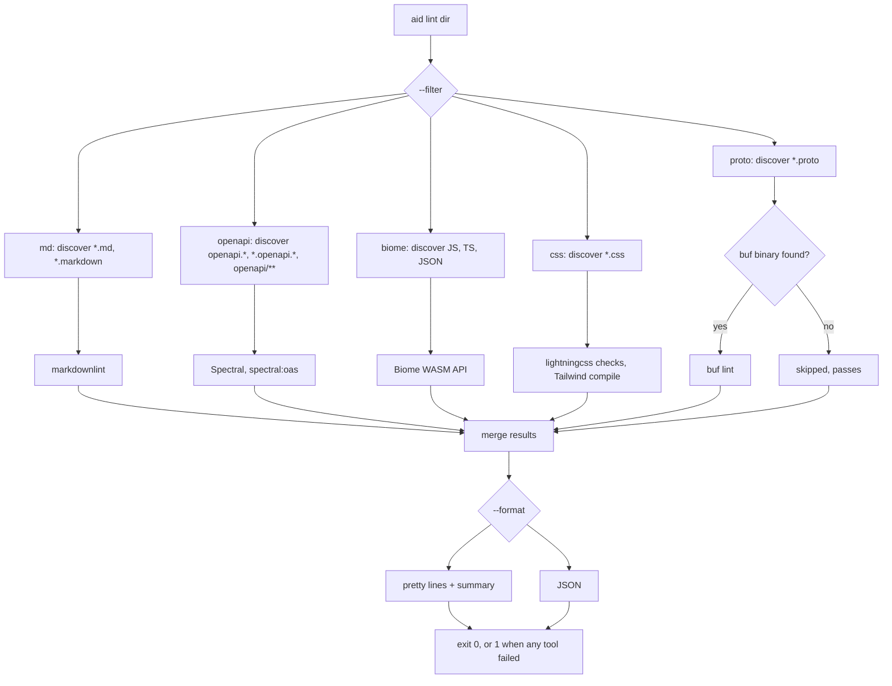

`aid lint` checks the files under a directory with five bundled tools and exits 1 when any of them reports an error. Every finding comes from one of these tools:

| Tool name | Linter | Files |
| --- | --- | --- |
| `md` | markdownlint | markdown |
| `openapi` | Spectral with the `spectral:oas` ruleset | OpenAPI specs |
| `biome` | Biome, through its WASM JavaScript API | JS, TS, and JSON |
| `css` | aid's CSS checks on lightningcss and the Tailwind compiler | CSS |
| `proto` | `buf lint` | Protobuf |

The glob patterns, ignored folders, and bundled rule sets for each tool are in [the lint defaults reference](../reference/lint-defaults.md). To change the rules, see [configuring the linters](./configuring.md).

## Use it

Point `aid lint` at your content folder:

```sh
aid lint docs
```

Each finding prints on one line, followed by a summary line:

```text
/home/me/site/docs/index.md:5:30  error  MD009  Trailing spaces: Expected: 0 or 2; Actual: 3
/home/me/site/docs/api/openapi.yaml:2:6  warn   info-contact  Info object must have "contact" object.
/home/me/site/docs/x.ts:2:1  error  lint/suspicious/noDebugger  This is an unexpected use of the debugger statement.

2 errors, 1 warning (md 1, openapi 1, biome 1, css 0, proto 0)
```

The line format is `file:line:col  severity  code  message`. The summary counts errors, warnings, and info findings, then the findings per tool. On a terminal, aid colors the severity and the code.

> [!IMPORTANT]
> `aid lint` does not read `aid.yaml`. It scans the whole directory you pass, and the current directory when you pass none. Pass your content folder. Otherwise Biome also checks `package.json`, your scripts, and every other JS, TS, and JSON file in the project, and `css` checks every CSS file.

`aid build` and `aid dev` do not run the linters. Run `aid lint` yourself or in CI.

## Flags

| Flag | Effect |
| --- | --- |
| `[dir]` | Directory to scan. Defaults to the current directory. |
| `--filter md,openapi,biome,css,proto` | Run only the listed tools. aid drops unknown names. When no valid name is left, every tool runs. |
| `--fix` | Write autofixes to disk. Only markdownlint fixes and Biome safe fixes apply. Spectral, `css`, and buf have no fix mode. |
| `--format pretty\|json` | Output format. Defaults to `pretty`. |

The generated [CLI reference](../reference/cli.md#aid-lint) lists the same flags.

With `--fix`, markdownlint writes every fixable violation back to the file and aid reports only the violations it could not fix. Biome applies its safe fixes through `lintContent` and writes the result back.

## How it works



1. aid parses `--filter` into a set of tools. No filter, or a filter with no valid names, selects all five.
2. For each selected tool, aid globs the target directory with that tool's patterns. It skips `node_modules`, `dist`, `.git`, and the other folders listed in [the lint defaults reference](../reference/lint-defaults.md).
3. aid runs the selected tools in parallel. A tool with no matching files passes with no findings.
4. Each tool finds its config file (see [configuring the linters](./configuring.md)) or falls back to the bundled default.
5. aid maps every finding to one shape: file, line, column, severity, code, message.
6. aid prints the report and exits 0 when every tool passed, 1 otherwise.

> [!WARNING]
> OpenAPI discovery goes by file name: `openapi.yaml`, `*.openapi.json`, or any YAML or JSON file under an `openapi/` folder. `aid build` detects OpenAPI by content instead, from a top-level `openapi:` or `swagger:` key. A spec named `api.yaml` renders as an API page but `aid lint` never checks it. Rename it to `api.openapi.yaml` or move it into an `openapi/` folder.

### Severity

aid maps each tool's levels onto three severities: `error`, `warn`, and `info`.

| Tool | `error` | `warn` | `info` |
| --- | --- | --- | --- |
| markdownlint | rules at the default severity | rules set to `warning` | none |
| Spectral | severity 0 (error) | severity 1 (warn) | severity 2 and 3 (info, hint) |
| Biome | `error`, `fatal` | `warning` | everything else |
| `css` | the checks marked `error` in [the CSS checks table](../reference/lint-defaults.md#css-checks-css) | the checks marked `warn` | none |
| buf | every finding | none | none |

Only `error` fails a tool. A run with warnings and no errors exits 0. buf reports no severity, so every buf finding is an error. The proto tool also fails when `buf lint` exits non-zero.

### How aid finds buf

markdownlint, Spectral, Biome, and the CSS checks ship inside aid. buf is a native binary, so aid looks for it in this order:

1. The per-platform buf binary embedded in aid, for macOS and Linux on arm64 and x64. In a compiled aid binary, aid copies it to a temporary file such as `/tmp/aid-buf-XXXXXX/buf` on first use, because the embedded file cannot be executed in place. Run from source, aid uses the copy in `node_modules`.
2. `buf` on your `PATH`.
3. If neither exists, aid skips the proto tool and the tool passes. Pretty output prints `proto: skipped (...)`, and the JSON result has `skipped: true` and a `reason`.

## CSS checks

The `css` tool runs every check in [the CSS checks table](../reference/lint-defaults.md#css-checks-css) on each CSS file. It has no config file. Each code matches the name of the Stylelint rule with the same intent. A run has two stages:

1. lightningcss, the CSS parser that `aid build` uses, parses the file. aid reports its parse errors and walks the parsed rules for unknown properties, values, selectors, at-rules, and media features, and for duplicates. Tailwind's directives, such as `@theme`, `@apply`, `@utility`, and `@custom-variant`, pass.
2. When the file imports `tailwindcss` or `aid/theme`, aid compiles it with Tailwind the way `aid build` does. Tailwind stops at the first error, such as an unknown utility in `@apply`, so aid reports at most one `tailwind` finding per file.

aid knows a name when a W3C spec defines it. `src/lint/css-data.json` holds the names, generated from the `@webref/css` and `@webref/elements` packages. Custom properties, vendor-prefixed properties, and custom elements pass. Values that lightningcss cannot parse pass when every keyword and unit in them appears in a CSS spec, so newer values such as `word-break: auto-phrase` do not fail.

```text
/home/me/site/main.css:4:15  error  tailwind  Cannot apply unknown utility class `pyy-2`
/home/me/site/main.css:7:3  error  property-no-unknown  Unknown property "colr"
```

## JSON output

`--format json` prints one object with a `results` array, one entry per tool that ran:

```json
{
  "results": [
    {
      "tool": "md",
      "ok": false,
      "diagnostics": [
        {
          "file": "/home/me/site/docs/index.md",
          "line": 5,
          "col": 30,
          "severity": "error",
          "code": "MD009",
          "message": "Trailing spaces: Expected: 0 or 2; Actual: 3"
        }
      ]
    },
    { "tool": "proto", "ok": true, "diagnostics": [], "skipped": true, "reason": "buf binary not available ..." }
  ]
}
```

- `tool` is `md`, `openapi`, `biome`, `css`, or `proto`.
- `ok` is false when the tool reported an error.
- `line` and `col` are absent when the tool gives no position.
- `skipped` and `reason` appear only when a tool had files but could not run.

The exit code follows the same rule as pretty output.

## Limitations

> [!WARNING]
> lightningcss records no position for a declaration. aid searches the rule's source for the property name, so a finding can point at the wrong line when a nested rule declares the same property first.
>
> buf errors that are not lint findings, such as a broken `buf.yaml`, do not print. The proto tool fails with no findings. Run `buf lint` by hand to see the message.
