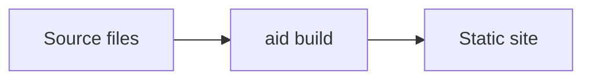

# Sample Site


This is a small fixture exercising every page kind aid supports in v0.1:

- This page (markdown).
- [`api`](./api) — an OpenAPI spec rendered with the embedded reference UI.
- [`events`](./events) — a `.proto` file rendered with aid's native proto UI.

```ts
const greet = (name: string): string => `hello, ${name}`
```


