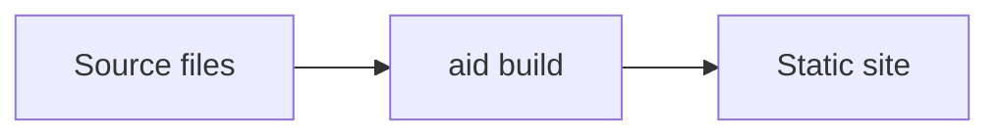

# Sample Site


This is a small fixture that covers every page kind aid supports in v0.1:

- This page (markdown).
- [`about`](./about), a hand-written HTML page.
- [`api`](./api), an OpenAPI spec that aid renders with the embedded reference UI.
- [`events`](./events), a `.proto` file that aid renders with its proto UI.

> [!NOTE]
> The fixture builds without network access.

```ts
const greet = (name: string): string => `hello, ${name}`
```


